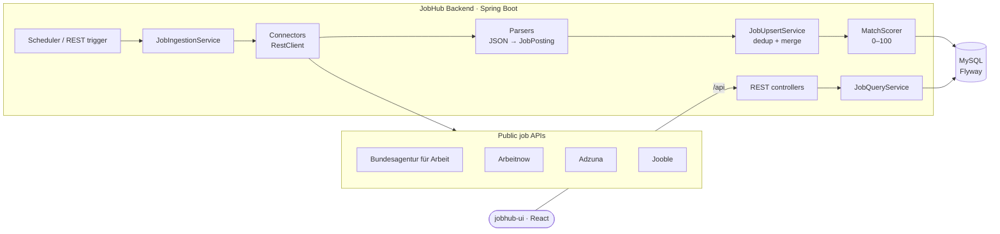

# JobHub – Backend Service

**JobHub** gathers Java job postings for the German market from several **free, public job APIs** into one place, removes duplicates across sources, and **ranks every job by how well it matches your profile**. This repository holds the **Spring Boot REST API**. The React frontend lives in **[jobhub-ui](https://github.com/alamsoftware68/jobhub-ui)**.


---

## Highlights

- **Pluggable source connectors**: each job board is a `JobSourceConnector` Spring bean. To add a new source, add one class; nothing else changes.
- **Parsers kept apart from HTTP**: JSON → `JobPosting` parsers are pure Java and unit-tested against recorded API fixtures
- **Cross-source deduplication**: postings are merged on a normalised `company | title | city` key, and the job keeps links to every site it appears on
- **Rule-based match score (0–100)**: skills, title keywords, location/remote fit and language fit. No AI, no paid APIs.
- **Scheduled + on-demand ingestion**: a `@Scheduled` cron (every 4 hours by default), a run at startup, and a REST trigger. Runs in the background with per-source statistics.
- **German-market details**: integrates the official **Bundesagentur für Arbeit** Jobsuche API (v6 search + lazy-loaded job descriptions), detects job language, and offers an *English-speaking jobs only* filter
- **Schema managed by Flyway**, `RestClient` for HTTP, Java records for config and DTOs, Actuator health endpoint

---

## Architecture



### Ingestion flow

1. `JobIngestionService` runs on startup, on the cron schedule, or on `POST /api/sources/refresh`
2. Each enabled connector queries its API with the profile's keywords and locations (`SearchCriteria`)
3. Parsers map each source's JSON into one common `JobPosting` model
4. `JobUpsertService` inserts new jobs or merges duplicates already found on other sources
5. `MatchScorer` calculates the profile match. Jobs that haven't been saved are cleaned up after 60 days.

---

## Job sources

| Source | API key | Default |
|--------|---------|---------|
| Bundesagentur für Arbeit (Jobsuche API v6) | Not needed (public key) | Enabled, Germany |
| Arbeitnow | Not needed | Enabled |
| Adzuna | Free key – [developer.adzuna.com](https://developer.adzuna.com) | Enabled once `ADZUNA_APP_ID` + `ADZUNA_APP_KEY` are set |
| Jooble | Free key – [jooble.org/api/about](https://jooble.org/api/about) | Enabled once `JOOBLE_API_KEY` is set |

---

## Match score (0–100)

| Component | Points |
|-----------|--------|
| Profile skills found in the job text | up to 55 (full points at 6 matching skills) |
| A search keyword in the job title | up to 20 |
| Location matches a preferred city, or the job is remote | up to 15 |
| Language fit (with *English-speaking jobs* on, German-required jobs lose points) | up to 10 |
| Excluded word in the title (e.g. *Werkstudent*) | score capped at 10 |

The logic is in [`MatchScorer.java`](src/main/java/com/jobsearch/service/MatchScorer.java) and is covered by `MatchScorerTest`.

---

## REST API

| Method | Path | Description |
|--------|------|-------------|
| GET | `/api/jobs` | Search jobs. Params: `q`, `source`, `location`, `country`, `remoteOnly`, `minScore`, `savedOnly`, `showHidden`, `postedWithinDays`, `englishOnly`, `sort=newest\|score`, `page`, `size` |
| GET | `/api/jobs/{id}` | Job details (loads the Arbeitsagentur description the first time it's opened) |
| PATCH | `/api/jobs/{id}` | Save or hide a job: `{ "saved": true }` / `{ "hidden": true }` |
| GET | `/api/jobs/countries` | Countries present in the stored jobs |
| GET | `/api/jobs/stats` | Job counts and last fetch time |
| GET | `/api/sources` | Status and last run of each source |
| POST | `/api/sources/refresh` | Fetch new jobs now (optional body with location/keyword) |
| GET / PUT | `/api/profile` | Read or update the profile; saving re-scores all jobs |
| GET | `/actuator/health` | Health check |

```bash
curl "http://localhost:8080/api/jobs?q=spring&minScore=60&sort=score&size=5"
```

---

## Tech stack

| Concern | Technology |
|---------|------------|
| Language | Java 21 (records) |
| Framework | Spring Boot 3.5: Web, Data JPA, Validation, Actuator, Scheduling |
| HTTP client | Spring `RestClient` |
| Database | MySQL 8, Flyway migrations |
| Testing | JUnit 5, fixture-based parser tests |
| Build / CI | Maven Wrapper, GitHub Actions |
| Local infra | Docker Compose (MySQL) |

---

## Project structure

```
src/main/java/com/jobsearch
├── source/
│   ├── JobSourceConnector.java   # connector interface
│   ├── JobPosting.java           # common model for all sources
│   ├── connector/                # Arbeitsagentur, Arbeitnow, Adzuna, Jooble (HTTP)
│   └── parser/                   # JSON → JobPosting (pure Java, unit-tested)
├── service/                      # ingestion, upsert + dedup, scoring, queries, profile
├── web/                          # REST controllers + DTOs
├── domain/ · repository/         # JPA entities + Spring Data repositories
├── config/                       # typed AppProperties, CORS, RestClient
└── util/                         # text normalisation, language detection, countries
src/main/resources/db/migration   # Flyway V1..V3
src/test                          # MatchScorerTest, ParserTest + JSON fixtures
```

---

## Getting started

### Prerequisites
- JDK 21
- Docker (for MySQL), or a local MySQL 8

### 1. Start MySQL

```bash
docker compose up -d
```

This creates the database `jobsearch` with user and password `jobsearch`, which match the defaults in `application.yml`.

### 2. Configure (optional)

Copy `.env.example` and set the values you need as environment variables. In IntelliJ, use Run Configuration → Environment variables.

| Variable | Default | Purpose |
|----------|---------|---------|
| `DB_URL` | `jdbc:mysql://localhost:3306/jobsearch…` | JDBC URL |
| `DB_USER` / `DB_PASSWORD` | `jobsearch` / `jobsearch` | Database credentials |
| `CORS_ORIGINS` | `http://localhost:5173` | Allowed frontend origin(s) |
| `FETCH_CRON` | `0 0 */4 * * *` | Ingestion schedule |
| `ADZUNA_APP_ID`, `ADZUNA_APP_KEY` | none | Turns on Adzuna |
| `JOOBLE_API_KEY` | none | Turns on Jooble |

### 3. Run

```bash
./mvnw spring-boot:run          # Windows: mvnw.cmd spring-boot:run
```

On first start, Flyway creates the schema and a sample profile, and the first fetch begins automatically. The log shows lines like `Arbeitsagentur: 184 fetched, 184 new, 0 duplicates`.

Then start the **[jobhub-ui](https://github.com/alamsoftware68/jobhub-ui)** frontend and open http://localhost:5173.

### Tests

```bash
./mvnw test
```

---

## Adding a new job source

1. Create a class in `source/connector/` that implements `JobSourceConnector` and annotate it with `@Component`
2. Return `JobPosting` objects from `fetch(SearchCriteria)`, ideally through a parser class with a JSON fixture test
3. Add a display name in `SourceNames` (and a badge colour in the UI's `format.ts`)

Spring picks it up automatically.

---

## Roadmap

- Application tracker (Saved → Applied → Interview → Offer)
- Company career feeds: Personio, Greenhouse, Lever
- Spring Security + JWT for multi-user hosting
- Email alerts for new high-scoring jobs
- Testcontainers integration tests for the repositories
- CV tailoring and cover letter drafts

---

## Author

**Alam** – Java full-stack developer (Java / Spring Boot, React) with 10+ years of experience
GitHub: [@alamsoftware68](https://github.com/alamsoftware68)
